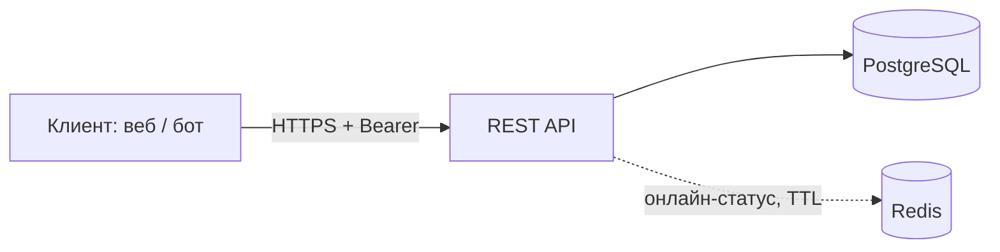

# Техническая документация: мессенджер учебных групп

## Архитектура (кратко)



* **API** — REST/JSON, описан в [`openapi.yaml`](../openapi.yaml) (OpenAPI 3.0.3), это единственный источник правды по контракту.
* **PostgreSQL** — группы, участники, сообщения (источник истины).
* **Redis** — онлайн-статус участников (ключ с TTL 60 с); потеря Redis не ведёт к потере сообщений.
* Аутентификация — Bearer-токен (JWT); `username` и права берутся из токена, клиент автора не передаёт.

## Структура репозитория

```
README.md                 # постановка, обзор, ссылки
openapi.yaml              # спецификация API
docs/user.md              # руководство пользователя
docs/tech.md              # этот документ
docs/swagger.html         # Swagger UI, читает ../openapi.yaml
scripts/validate_spec.py  # проверка спецификации
```

## Как собрать и запустить документацию

```bash
pip install openapi-spec-validator pyyaml
python scripts/validate_spec.py            # проверка структуры OpenAPI + список операций

python -m http.server 8080                 # из корня репозитория
# открыть http://localhost:8080/docs/swagger.html  (Swagger UI подгружается с CDN jsDelivr)
```

Mock-сервер по спецификации (без написания кода; нужен Node.js):

```bash
npx @stoplight/prism-cli mock openapi.yaml      # http://127.0.0.1:4010
curl -H "Authorization: Bearer test" http://127.0.0.1:4010/groups/1/messages
```

Альтернативы Swagger UI: Redoc (`npx @redocly/cli preview-docs openapi.yaml`) или вставка `openapi.yaml` на editor.swagger.io.

## Модель данных

### Сообщение

| Поле | Тип | Ограничения | Смысл |
|---|---|---|---|
| `id` | bigint | растёт монотонно | идентификатор и **курсор пагинации** |
| `group_id` | bigint | FK → группа | группа-получатель |
| `author` | string | участник группы на момент отправки | автор (из токена) |
| `text` | string | 1–2000 символов | текст |
| `created_at` | timestamp (UTC, ISO 8601) | выставляет сервер | время отправки |

Таблицы: `groups(id, name UNIQUE, created_at)`, `memberships(group_id, username, joined_at, PK(group_id, username))`,
`messages(id, group_id, author, text, created_at)`.
Индекс `messages(group_id, id DESC)` обслуживает и историю, и пагинацию.

## Пагинация

Используется **keyset-пагинация** (по курсору), а не `OFFSET`.

* Запрос: `GET /groups/{id}/messages?limit=20&before_id=41`.
* Ответ: `{ "items": [...], "next_before_id": 22 }`, где сообщения идут от новых к старым, а `next_before_id` — наименьший `id` на странице
  (или `null`, если страница последняя).
* SQL: `SELECT … FROM messages WHERE group_id = :g AND id < :before_id ORDER BY id DESC LIMIT :limit + 1` (лишняя строка нужна, чтобы понять, есть ли следующая страница).

Почему не `OFFSET`: при поступлении новых сообщений номера страниц «плывут» (дубли и пропуски), а `OFFSET N` читает и отбрасывает N строк,
что тормозит на длинных историях. Курсор по `id` стабилен и использует индекс.

Ограничения `limit`: 1–100, по умолчанию 20.

## Поиск

`GET /groups/{id}/messages/search?q=…` ищет подстроку без учёта регистра (`text ILIKE '%' || :q || '%'`),
ограничение по группе, сортировка и пагинация те же, что у истории. Минимальная длина `q` — 2 символа
(защита от выборки «всё подряд»). Спецсимволы `%` и `_` в `q` экранируются.
Для больших объёмов — индекс `GIN (text gin_trgm_ops)` расширения `pg_trgm` или полнотекстовый поиск (`tsvector`).

## Договорённости

* **Формат ошибок:** `{ "code": "<snake_case>", "message": "<текст на русском>" }`. Коды: `unauthorized` (401), `not_a_member` (403),
  `not_found` (404), `group_exists` (409), `validation_error` (422).
* **Время:** всегда UTC в формате ISO 8601 (`2026-10-05T10:15:00Z`).
* **Идемпотентность:** повторное `POST /members` возвращает 200 вместо 201 и не создаёт дубликат.
* **Права:** читать историю и искать может только участник; вышедший из группы теряет доступ, но его сообщения остаются.
* **Именование:** пути — существительные во множественном числе; `/users/me/...` — ресурсы текущего пользователя.

## Конфигурация (переменные окружения сервера)

| Переменная | Назначение | Пример |
|---|---|---|
| `DATABASE_URL` | подключение к PostgreSQL | `postgresql://user:pass@db:5432/messenger` |
| `REDIS_URL` | подключение к Redis | `redis://redis:6379/0` |
| `JWT_SECRET` | ключ проверки токенов (только из окружения, не в репозитории) | задаётся при деплое |
| `ONLINE_TTL_SECONDS` | время жизни отметки «онлайн» | `60` |

## Как менять API

1. Изменить `openapi.yaml`.
2. Запустить `python scripts/validate_spec.py`.
3. Обновить `docs/user.md`, если изменилось видимое пользователю поведение.
4. Поднять `info.version` (SemVer): новые необязательные поля — minor, несовместимые изменения — major.
